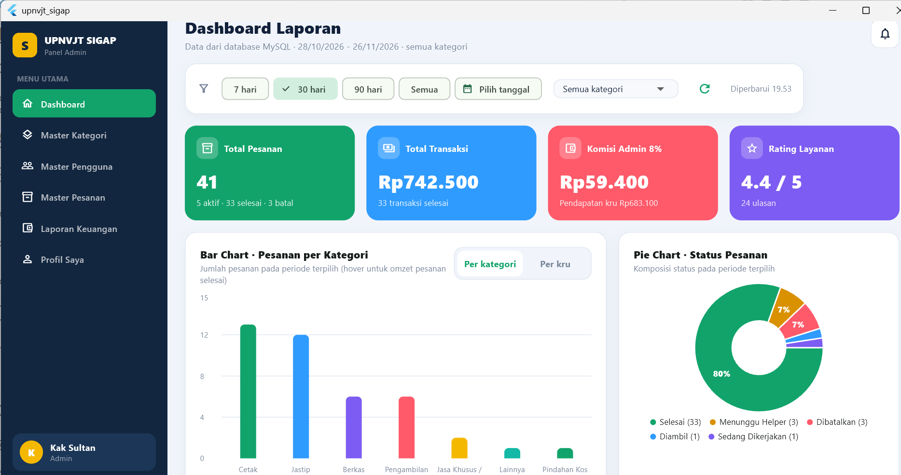
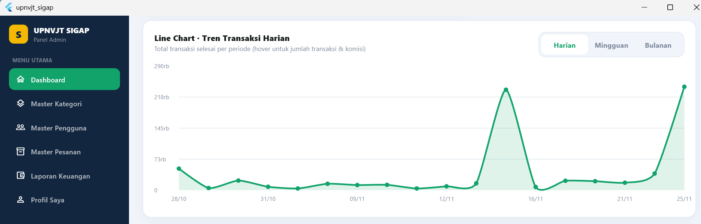
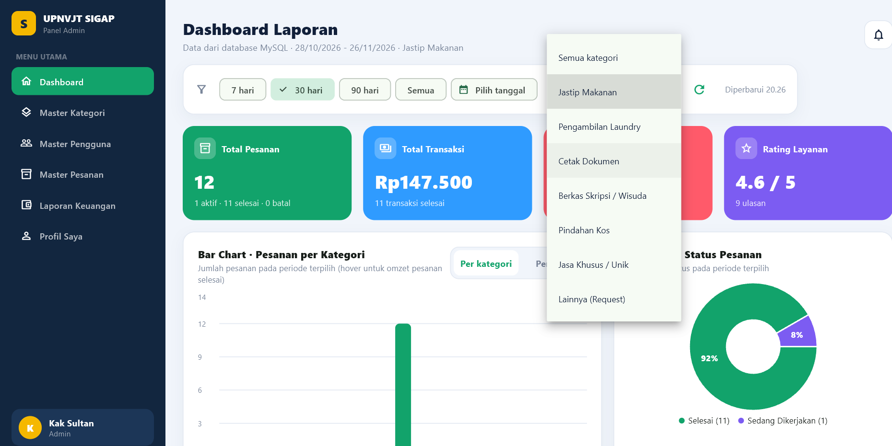

# UPNVJT SIGAP — Aplikasi Desktop Admin (Flutter) + Dashboard Laporan MySQL

Aplikasi desktop untuk administrasi layanan bantuan antar mahasiswa UPN "Veteran" Jawa Timur.
Struktur model mengikuti PDM SIGAP: `users`, `kategori_layanan`, `pesanan`, `negosiasi`, `ulasan`,
dan `transaksi_keuangan`.

Tugas **Dashboard & Data Reporting**: halaman **Dashboard Laporan** mengambil data langsung dari
**MySQL** lewat query SQL, punya **filter & grouping**, dan menampilkan **bar chart, line chart, dan pie chart**.

## Screenshot Dashboard

> Ganti/tambahkan gambar di folder `docs/screenshots/` (nama berkas sama dengan di bawah).





## Pemenuhan indikator tugas

| Indikator | Implementasi |
|---|---|
| 1. Data dari database dengan query yang sesuai | Semua angka & grafik berasal dari query MySQL di [`lib/data/report_queries.dart`](lib/data/report_queries.dart) (`JOIN`, `LEFT JOIN`, `GROUP BY`, `SUM`, `COUNT`, `AVG`, `DATE_FORMAT`), dijalankan oleh [`report_repository.dart`](lib/data/report_repository.dart) lewat koneksi [`db.dart`](lib/data/db.dart). Salinan query yang bisa dijalankan manual: [`sql/03_query_laporan.sql`](sql/03_query_laporan.sql). |
| 2. Filter atau grouping pada laporan | **Filter**: periode (7/30/90 hari, semua, atau rentang tanggal kustom) dan kategori layanan. **Grouping**: bar chart per *kategori* / per *kru*; line chart per *harian* / *mingguan* / *bulanan*; pie per status pesanan. Filter dikirim sebagai parameter query (`:dari`, `:sampai`, `:kat`). |
| 3. Minimal 3 jenis chart | **Bar chart** (pesanan per kategori/kru), **line chart** (tren transaksi per periode), **pie chart** (komposisi status pesanan) — memakai paket `fl_chart`. |

Selain itu ada 4 kartu ringkasan (total pesanan, total transaksi, komisi admin 8%, rating) dan tabel pesanan terbaru, semuanya mengikuti filter.

## Menyiapkan MySQL

Butuh MySQL 8.x (atau MariaDB 10.5+) yang berjalan di komputer Anda.

```bash
mysql -u root -p < sql/01_schema.sql   # membuat database sigap_db + 6 tabel PDM
mysql -u root -p < sql/02_seed.sql     # data contoh (70 pesanan, 57 transaksi, 40 ulasan)
```

Tanggal pada data contoh dibuat relatif terhadap waktu import (`NOW()`), sehingga filter 7/30/90 hari selalu berisi data.
Bila database SIGAP kelompok sudah ada, lewati `01_schema.sql` dan pastikan nama tabel/kolom sesuai
[`PDM_MAPPING.md`](PDM_MAPPING.md).

Disarankan membuat user khusus (hanya baca) untuk aplikasi, bukan `root`:

```sql
CREATE USER 'sigap_app'@'localhost' IDENTIFIED BY 'ganti_kata_sandi';
GRANT SELECT ON sigap_db.* TO 'sigap_app'@'localhost';
```

### Konfigurasi koneksi

Nilai bawaan: `127.0.0.1:3306`, user `root`, kata sandi kosong, database `sigap_db`. Ubah lewat environment variable:

| Variable | Bawaan | Keterangan |
|---|---|---|
| `SIGAP_DB_HOST` | `127.0.0.1` | alamat server MySQL |
| `SIGAP_DB_PORT` | `3306` | port |
| `SIGAP_DB_USER` | `root` | user (disarankan `sigap_app`) |
| `SIGAP_DB_PASSWORD` | *(kosong)* | kata sandi |
| `SIGAP_DB_NAME` | `sigap_db` | nama database |
| `SIGAP_DB_SECURE` | `true` | isi `false` bila server tanpa TLS |

Contoh (PowerShell):

```powershell
$env:SIGAP_DB_USER="sigap_app"; $env:SIGAP_DB_PASSWORD="ganti_kata_sandi"
flutter run -d windows
```

Bila koneksi gagal, Dashboard menampilkan pesan kesalahan beserta alamat server yang dicoba dan tombol **Coba lagi**.

## Cara menjalankan di Windows

Pastikan Flutter SDK sudah terpasang dan `flutter doctor` tidak menunjukkan masalah untuk Windows desktop.

1. Ekstrak ZIP / clone repositori, lalu masuk ke folder `sigap`.
2. Siapkan MySQL (bagian di atas).
3. Jalankan `flutter create --platforms=windows .` untuk membuat berkas platform desktop yang belum disertakan.
4. Jalankan `flutter pub get`.
5. Jalankan `flutter run -d windows`.

Gunakan jendela desktop sekitar 1200 × 720 atau lebih besar.

## Akun demo untuk login Admin

- Email: `sultan@email.com`
- Kata sandi: `admin123`

Login masih memakai data demo di memori (bukan tabel `users` MySQL). Pada MySQL, akun yang sama ada di `sql/02_seed.sql`
dengan hash SHA-256 yang identik.

## Fitur yang tersedia

- **Dashboard Laporan (MySQL)**: KPI, bar/line/pie chart, filter periode & kategori, grouping, tabel pesanan terbaru.
- Login Admin (panel desktop dibatasi untuk role Admin). Registrasi mandiri hanya untuk Pelanggan; Kru hanya didaftarkan Admin.
- CRUD master kategori layanan (termasuk kategori tetap **Lainnya (Request)**) dan master pengguna.
- Kelola status & ubah data pesanan, status kru Free/Sibuk, dan **negosiasi harga** per pesanan.
- Laporan Keuangan dan ekspor CSV (teks yang bisa disalin).
- Profil admin, ubah kata sandi, logout.

## Catatan penting tentang database

- **Dashboard Laporan sudah memakai MySQL aktif** (query SQL langsung).
- Menu lain (Master Kategori, Pengguna, Pesanan, Laporan Keuangan, Profil, dan login) **masih memakai `AppStore` berbasis
  memori** (`lib/data/app_store.dart`). Perubahan data di menu tersebut belum tersimpan ke MySQL, sehingga angka
  Dashboard (dari MySQL) dan menu lain (data demo memori) bisa berbeda. Migrasi menu lain ke repository MySQL adalah tahap
  berikutnya dan dapat mengikuti pola `report_repository.dart`.
- Skema MySQL mengikuti PDM; deskripsi & warna kategori pada UI hanya untuk tampilan dan bukan kolom PDM.

## Pemetaan model ke PDM

| Model aplikasi | Tabel PDM | Keterangan |
|---|---|---|
| `UserModel` | `users` | data akun dan role |
| `KategoriLayanan` | `kategori_layanan` | nama kategori dan tarif dasar per km |
| `Pesanan` | `pesanan` | pelanggan, kru, kategori, lokasi, waktu, biaya, status |
| `Negosiasi` | `negosiasi` | tawaran harga, pengirim, status tawaran |
| `Ulasan` | `ulasan` | rating dan komentar pesanan |
| `TransaksiKeuangan` | `transaksi_keuangan` | total bayar, komisi admin, pendapatan kru |

## Struktur folder

```text
sql/
  01_schema.sql           # skema MySQL (6 tabel PDM)
  02_seed.sql             # data contoh
  03_query_laporan.sql    # query laporan yang dipakai dashboard
docs/screenshots/         # screenshot untuk README
lib/
  main.dart
  core/theme.dart
  models/models.dart
  data/
    app_store.dart            # data demo di memori (menu selain dashboard)
    db.dart                   # koneksi MySQL (mysql_client)
    report_queries.dart       # query SQL laporan
    report_repository.dart    # filter, grouping, dan pemetaan hasil query
  widgets/common.dart
  pages/
    dashboard_page.dart       # Dashboard Laporan (filter + bar/line/pie chart)
    auth_pages.dart, home_shell.dart, kategori_page.dart, pengguna_page.dart,
    pesanan_page.dart, laporan_page.dart, profil_page.dart, negosiasi_dialog.dart
```

## Checklist sebelum dikumpulkan

- [ ] MySQL berjalan, `01_schema.sql` dan `02_seed.sql` sudah diimpor.
- [ ] `flutter pub get` dan `flutter analyze` tanpa error.
- [ ] `flutter run -d windows`, login dengan akun demo.
- [ ] Dashboard menampilkan 3 chart; ganti filter periode, kategori, dan grouping — angka dan grafik berubah.
- [ ] Screenshot dashboard disimpan di `docs/screenshots/` dan tampil di README.
- [ ] Repositori GitHub dibuat, kode di-push, link dikumpulkan oleh perwakilan kelompok.
